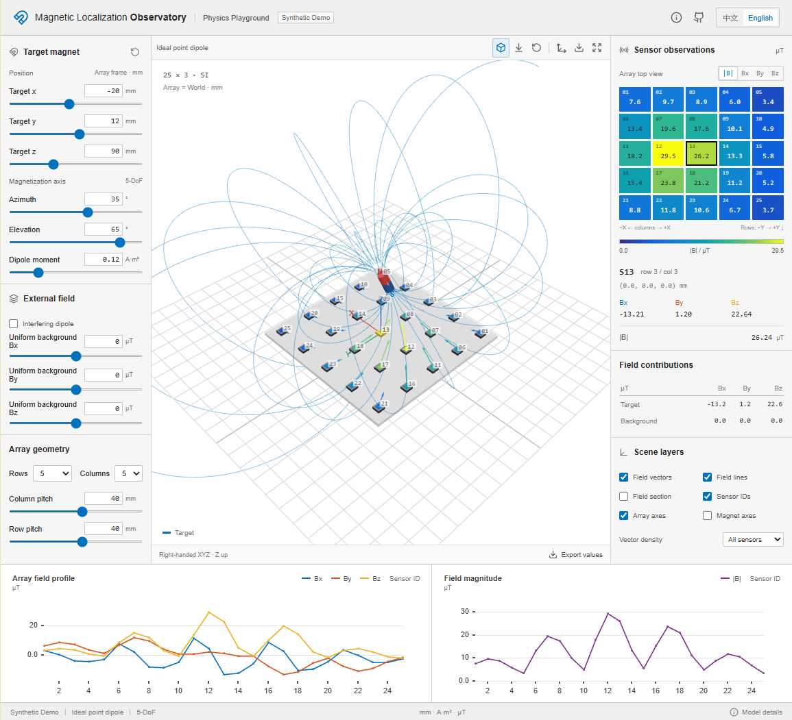
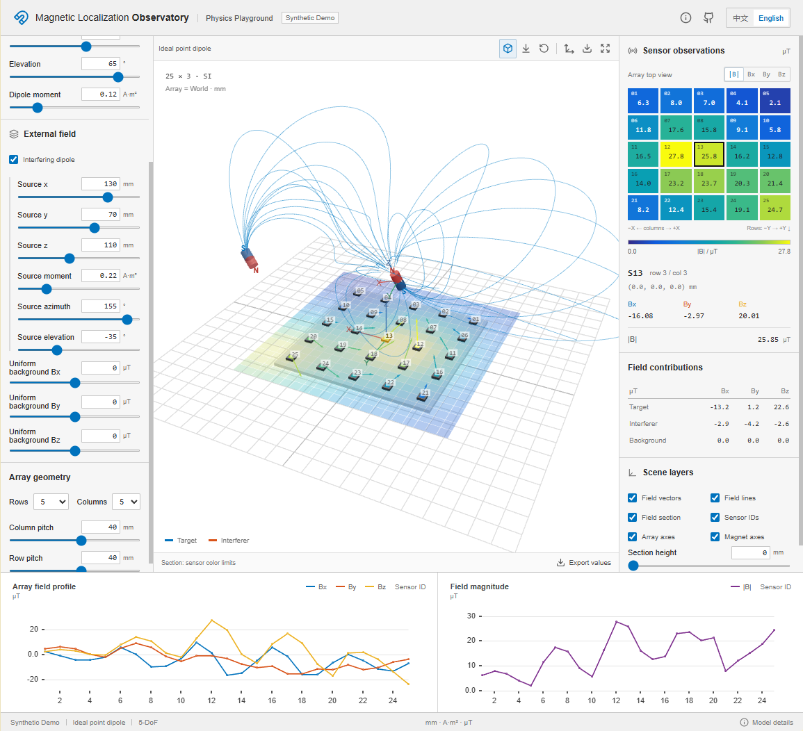

# 磁定位观测台

[English](README.md) · [在线演示](https://shenmiaozhang.github.io/magnetic-localization-observatory/?lang=zh)

中英文交互式磁场物理演示。使用理想 SI 点偶极子模型，在浏览器中计算磁体与
三轴传感器阵列的响应。**全部显示值均为合成数据，不包含真实实验记录。**

## 界面预览

**单磁源：无外部干扰**



**双磁源：叠加干扰与磁场截面**



## 功能

- 拖动磁体或修改 XYZ、方位角、仰角与磁偶极矩。
- 添加第二个偶极子及均匀背景场。
- 查看磁场向量、磁力线、截面、传感器热力图与 Bx/By/Bz 曲线。
- 查看所选传感器处各磁源的分量贡献。
- 修改阵列行列数、间距、可视化密度。
- 切换中英文；导出合成数值与三维场景 PNG。

界面采用白底、灰黑坐标与常见 MATLAB 蓝／橙／黄曲线配色。连续强度色标为
独立插值实现，不是对专有命名色表的精确复制。

## 启动与检查

推荐 Node 24。

```sh
npm ci
npm run dev
```

中文：`http://127.0.0.1:5174/?lang=zh`；英文：同地址使用 `?lang=en`。

```sh
npm test
npm run build
npm run test:ui
```

浏览器检查默认启动临时生产预览（4174 端口）。Windows 使用本机 Chrome；其他
平台需先运行 `npx playwright install chromium`。可用 `CHROME_PATH` 指定浏览器，
用 `OBSERVATORY_URL` 检查已有演示地址。

## 物理边界

位置为 mm，计算转换到 m；磁偶极矩为 A·m²，输出为 µT。阵列采用右手系，X
沿列、Y 沿行、Z 垂直向上；方位角由 +X 转向 +Y，仰角由 XY 平面转向 +Z。
磁化单位轴只有两个姿态自由度，轴向自旋不是本模型中可独立观测的第六自由度。

默认 5×5、40-mm 阵列仅为通用合成示例，不是实际设备标定。距点源 5 mm 内的
值保持未定义。磁力线是 RK4 积分曲线，并非粒子轨迹；箭头长度归一化，量值
应读共享色标。截面颜色按传感器色标范围截断。

## 公开范围

公开仓库仅包含理想物理演示，不含实验记录、回放入口、私有数据、配准轨迹、
逆定位求解器或机器人控制接口。不作实验精度或安全主张。

构建检查使用明确的源文件／产物白名单；`public/` 仅允许站点图标和第三方许可文本。
GitHub Pages 仅发布经过检查的 `dist/`。可以从个人主页链接演示，无需公开研究仓库。

采用 [MIT 许可证](LICENSE)，作者 Miaozhang Shen（2026）。第三方说明见
[NOTICE.md](NOTICE.md)。详细公式和开发结构见英文 README。
